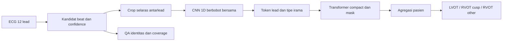

# Kajian literatur lokalisasi asal PVC dari ECG 12 lead

Tanggal pencarian: **7 Oktober 2026**. Ruang lingkup: asal anatomi PVC/aritmia ventrikel idiopatik, CNN–Transformer dan pembanding terkait; deteksi waktu PVC dibahas sebagai tahap masukan. Pengguna memilih **kajian saat ini saja**, tanpa pemantauan rutin. Kajian terarah ini bukan systematic review dengan pencarian database berlangganan/PRISMA, dan tidak menjamin seluruh publikasi telah terjangkau.

**Keputusan utama:** Nakasone dkk. merupakan acuan CNN–Transformer paling relevan di antara studi yang diperiksa, karena memadukan masukan PVC–sinus, hubungan antarlead, dan evaluasi eksternal. Untuk proyek ini, prioritas penelitian adalah **identitas denyut → representasi morfologi antarlead → pembandingan terkontrol pada pasien → generalisasi**. Belum ada bukti bahwa mengganti arsitektur saja akan menghasilkan macro-F1 tiga kelompok 0,9.

“Terbaik” di sini berarti paling berguna untuk pertanyaan/metode tertentu, bukan pemenang universal. Nama jurnal tidak dipakai sebagai pengganti mutu evaluasi. Status kuartil Scopus/SJR per tahun dan kategori belum diaudit; jangan menulis semua referensi di bawah sebagai jurnal Q1.

## Cara membaca bukti

Sumber utama: publisher, PubMed, naskah penulis/repository universitas, dan repository kode yang ditautkan paper. Review digunakan untuk menemukan studi, kemudian klaim teknis diperiksa pada sumber primer. Pencarian mencakup kombinasi `PVC origin localization`, `12-lead ECG CNN transformer`, `dual rhythm sinus PVC`, `recurrent convolution attention`, `ECGNet PVCsNet`, serta penelusuran judul/DOI dan publikasi 2025–2026. Jejak sumber dan tingkat akses ada pada [register sumber](BUKTI_PENCARIAN_PVC_20261007.json).

Full text dibaca untuk Nakasone, Miyamae, Zheng, Kujime, naskah preprint Shahsavari dan naskah penulis uPVC-Net. Zhao, ECGNet, PVCsNet, He dan Nakamura terutama diperiksa melalui abstrak primer; Wang melalui abstrak publisher. Baek/Seo berupa abstrak supplement. Detail yang tidak tersedia tidak diasumsikan telah diperiksa.

Bedakan lima hal sebelum membandingkan angka:

1. **Target:** deteksi PVC versus non-PVC, kanan/kiri, beberapa wilayah, atau koordinat dalam mm.
2. **Unit:** beat, gambar, rekaman, atau pasien. Banyak beat dari pasien yang sama tidak menambah pasien independen.
3. **Metrik:** accuracy, F1 kelas positif, macro-F1, dan AUC memiliki arti berbeda.
4. **Coverage:** semua pasien versus kasus yang mendapat keputusan setelah abstention/seleksi.
5. **Evaluasi:** pasien terpisah, internal saja, atau kohort eksternal/prospektif.

## Matriks penelitian utama

Angka pada tabel adalah laporan masing-masing penulis, bukan reproduksi lokal atau peringkat berdasarkan satu endpoint yang sama.

| Studi dan sumber primer | Masukan/metode dan evaluasi yang terverifikasi | Hasil yang dilaporkan | Penilaian untuk proyek |
|---|---|---|---|
| **Nakasone, Nishimori dkk., Europace 2024** — [paper](https://academic.oup.com/europace/article/26/10/euae240/7756618), [full text resmi](https://da.lib.kobe-u.ac.jp/da/kernel/0100491798/0100491798.pdf) | 593 pasien, 11 pusat; 100 pasien eksternal Belgia. Inferior-axis idiopathic PVC, target kanan/kiri. PVC dan sinus: crop 0,8 s pada 500 Hz. Shared 1D ResNet50 per lead → vektor 256 dimensi → Transformer → classifier; ensemble lima model. | Eksternal: accuracy **0,84**, AUC **0,91**, F1 **0,77**; PVC saja accuracy 0,74/F1 0,68. | Acuan langsung CNN–Transformer dengan bukti generalisasi. Target biner dan populasi berbeda; F1 ini bukan macro-F1 tiga kelompok. |
| **Miyamae, Inden dkk., Circulation Journal 2026** — [versi final](https://www.jstage.jst.go.jp/article/circj/90/7/90_CJ-25-0534/_article/-char/en), [metode lengkap](https://www.jstage.jst.go.jp/article/circj/advpub/0/advpub_CJ-25-0534/_html/-char/en) | 314 pasien satu pusat, khusus transition zone V3/V4; split pasien 3:1:1, holdout 63. PVC + intrinsic QRS, crop 500 ms/500 Hz, CNN 1D tiga lapis. Lima pasangan/pasien untuk train/validation, satu pasangan untuk holdout. | Paired: accuracy **92,1%**, macro-F1 **0,91**, AUC **0,96**. PVC saja: accuracy 0,76, macro-F1 0,74, AUC 0,80. | Bukti ablation input yang sangat relevan. Hasil biner RVOT/LVOT pada kelompok terpilih, belum validasi eksternal. Advance online 2025; issue final 2026. |
| **Shahsavari, Delfan & Forouzanfar, IEEE TIM 2024** — [metadata/abstrak institusi penulis](https://pure.etsmtl.ca/en/publications/localizing-the-origin-of-idiopathic-ventricular-arrhythmias-from-/), [preprint](https://arxiv.org/abs/2302.10824) | 334 pasien Ningbo; CNN–BiLSTM dengan temporal attention, biner LVOT/RVOT. Naskah 2023: padding 25 s, low-pass 25 Hz, downsample 50 Hz, normalisasi rekaman, sepuluh fold train/validation/test 80/10/10. Detail preprocessing berasal dari preprint, belum dicocokkan seluruhnya ke full text jurnal. | Jurnal: accuracy **94%**, F1 **96%**, AUC **93%**. Preprint lebih rinci: accuracy 0,943/F1 0,963. | Pembanding waveform paling dekat keluarga dataset kita. Attention recurrent bukan Transformer. Endpoint biner; belum bukti tiga kelompok atau eksternal. **Kini terverifikasi sebagai publikasi jurnal**, bukan hanya preprint. |
| **Zhao dkk., Heart Rhythm 2022** — [abstrak primer](https://pubmed.ncbi.nlm.nih.gov/35843464/) | 759 pasien setelah eksklusi; 605 development, 104 eksternal, 50 prospektif. Random forest dari fitur ECG permukaan; target LVOT/RVOT. | Accuracy eksternal **94,23%**, prospektif **94%**; AUC development 0,96. | Acuan pembanding fitur dengan evaluasi klinis kuat. Full text/definisi seluruh fitur belum diakses; belum dapat menyalin pipeline secara lengkap. |
| **Zheng dkk., Frontiers in Cardiovascular Medicine 2022** — [paper asal](https://www.frontiersin.org/journals/cardiovascular-medicine/articles/10.3389/fcvm.2022.809027/full) | 545 pasien, 18.612 ECG terpilih, split pasien 436/55/54. Kompleks PVC/VT dipilih operator; window QRS 100–500 ms dan ExtraTrees/seleksi model; beberapa skema sampai 21 lokasi. | Accuracy klasifikasi 21 lokasi **98,24%**, pada sampel ECG yang digunakan studi. | Target/kohort/unit berbeda dari proyek. Bagian pemilihan model menyebut akurasi testing cohort, sedangkan bagian hasil juga menyebut blind test; independensi tahap akhir perlu klarifikasi. Ini ambiguitas pelaporan, bukan bukti pasti kebocoran. |
| **Kujime, Seno dkk., Journal of Arrhythmia 2024** — [full text](https://onlinelibrary.wiley.com/doi/full/10.1002/joa3.13096) | 84 pasien/265 rekaman privat; anotasi per waktu BG, sinus, PVC kiri/kanan. CNN–BLSTM semantic segmentation, patient-group fivefold; keputusan rekaman kiri/kanan/Neutral. V2/V6 menjadi pasangan terbaik di studi. | Data publik: accuracy **0,916**, F1 **0,943**, AUC **0,848** pada kasus determinable; **28,4% Neutral** pada threshold 0,4. | Berguna untuk memisahkan pengenalan beat dan origin. Membutuhkan anotasi yang belum ada lokal. F1 selektif harus disertai coverage; Neutral bukan kelas anatomi ketiga. |
| **Zhang dkk., ECGNet, IEEE TBME 2023** — [abstrak primer](https://pubmed.ncbi.nlm.nih.gov/35881595/) | 609 gambar ECG/310 pasien; dense blocks, convolution khusus, divergent paths dan loss imbalance; tugas klasifikasi asal multikelas. | Accuracy **91,74%**. | Ada jalur penelitian berbasis gambar, tetapi split pasien, rincian kelas, dan validasi eksternal belum diperiksa pada full text. Tidak cukup alasan untuk mengubah CSV menjadi gambar. |
| **Guo, Gu dkk., PVCsNet, IEEE JBHI 2025** — [abstrak primer](https://pubmed.ncbi.nlm.nih.gov/39348245/) | Gambar ECG; CNN residual dengan squeeze-and-excitation attention; enam asal: RVOT, LVOT, papillary muscle, valve annulus, summit, His–Purkinje. Full text belum diakses. | Overall accuracy **94,49%**. | SE attention bukan Transformer. Jumlah pasien/split pasien/validasi eksternal belum terverifikasi dari full text; skor tidak langsung dibandingkan dengan macro-F1 kita. Online 2024, issue final 2025. |
| **Wang, Feng dkk., JICE 2024** — [abstrak publisher](https://link.springer.com/article/10.1007/s10840-023-01551-7) | Dua tahap ML untuk 11 wilayah; enam fitur termasuk Peak_index; tahap kedua membedakan kelas yang sering tertukar. | Exact accuracy **75,87% → 76,84%**. Rank accuracy **93,49%** mengizinkan wilayah tetangga. | Menggambarkan kesulitan lokalisasi rinci. Perbaikan pada kelas sulit relevan, tetapi adjacent-region accuracy bukan ketepatan kelas asal. |
| **He, Nie dkk., Physiological Measurement 2020** — [abstrak primer](https://pubmed.ncbi.nlm.nih.gov/32252035/) | 249 pasien/374 kelompok sampel/11 wilayah; pengenalan beat otomatis lalu ML. Split 70/30 dilaporkan pada kelompok sampel; pemisahan seluruh pasien belum dapat dipastikan dari abstrak. | Deteksi accuracy **97,6%**; origin exact accuracy **70,7–74,1%**, rank accuracy 91,5–93,2% dengan penggabungan tetangga. | Detektor bagus tidak otomatis menghasilkan lokalisasi rinci bagus. Audit grouping pasien diperlukan bila mengadaptasi protokol. |
| **Nakamura dkk., CVDHJ 2021** — [abstrak primer](https://pubmed.ncbi.nlm.nih.gov/35265893/) | 111 pasien/116 PVC; empat kelompok kanan/kiri × OT/other; SVM, CNN, pakar dan algoritme ECG dibandingkan. | Weighted accuracy SVM **0,85**, CNN **0,80**; biner SVM 0,94/CNN 0,87. | Kontrol sederhana tetap perlu. Klaim umum bahwa neural pasti lebih baik tidak didukung studi ini. |
| **Yang, Yu dkk., IEEE TBME 2018** — [sumber primer](https://pubmed.ncbi.nlm.nih.gov/28952932/) | CNN dari simulasi dengan lead-field anatomi pasien; 25 segmen dan endo/epi; evaluasi manusia 90 PVC pada sembilan pasien. | Mean galat posisi manusia sekitar **11 mm**. | Pionir lokalisasi, tetapi memerlukan geometri/model jantung. Galat mm tidak sebanding dengan macro-F1 klasifikasi CSV kita. |

## Perkembangan 2026 dan tahap deteksi

**Kelompok Seo/Baek:** [abstrak EHJ Digital Health Januari 2026](https://academic.oup.com/ehjdh/article/7/Supplement_1/ztaf143.133/8423015) dan [EP-AI ASSIST, Europace Juni 2026](https://academic.oup.com/europace/article/28/Supplement_1/euag105.024/8716641) sama-sama melaporkan 584 pasien, 470 ECG terpilih, dua model Transformer, dan macro-AUC **0,915** untuk empat kelompok. Kesesuaian angka dan sebagian penulis mengindikasikan kemungkinan kohort yang sama/terkait; jangan menghitungnya sebagai dua validasi independen tanpa konfirmasi. Hubungan 584 pasien dengan 470 ECG dan detail pipeline belum cukup jelas. Keduanya abstrak supplement, belum full paper yang memungkinkan reproduksi lengkap; macro-AUC tersebut bukan macro-F1.

**Hamami dkk., uPVC-Net:** [naskah penulis v2](https://arxiv.org/abs/2506.11238) mencantumkan publikasi IEEE TBME 2026, [DOI jurnal](https://doi.org/10.1109/TBME.2026.3655531); [laboratorium penulis](https://www.aimlab-technion.com/post/upvc-net-a-universal-premature-ventricularcontraction-detection-deep-learning-algorithm) menautkan versi terbit. Detektor single-lead memakai STFT/BiGRU, masukan delapan detik, training multisumber/multilead dan leave-one-dataset-out. Empat sumber: MIT-BIH, Icentia11k, INCART, CPSC2021. OOD AUROC **0,9776–0,9912**, tetapi F1 pada threshold 0,5 sekitar **0,6633–0,8289**. Ini bukti resep generalisasi detektor, bukan asal PVC. Kode/bobot siap pakai belum terverifikasi; metode/angka dibaca pada naskah penulis, bukan reproduksi versi publisher.

Paper [TransECG-Net 2026](https://www.frontiersin.org/journals/cardiovascular-medicine/articles/10.3389/fcvm.2026.1802210/full) juga ditemukan. Masukan dan endpoint-nya klasifikasi beat satu lead; penulis menyatakan split pada heartbeat sehingga pasien dapat muncul di beberapa subset. Accuracy 99,52% di studi tersebut tidak menjadi sasaran pembanding untuk lokalisasi pasien baru tiga kelompok.

## Pemeriksaan keterulangan kode

Nakasone menautkan [repository penulis](https://github.com/macostrail/dual-rhythm-model). Pemeriksaan statis menemukan loader sinus/PVC terpisah, konfigurasi `(12, 400)`, split 60/20/20 dan file training. Namun [BaseModel](https://github.com/macostrail/dual-rhythm-model/blob/main/models/base_model.py) yang terlihat membuat cabang `timm`/ConvModel dan menggabungkan dua representasi; implementasi lengkap shared-1D-CNN → lead-token Transformer seperti diagram paper belum ditemukan pada berkas model yang diperiksa. Tautan kode tidak dengan sendirinya memastikan reproduksi arsitektur utama. Checkpoint, data pasien, dan lisensi penggunaan ulang kode belum terverifikasi tersedia. Tidak ada kode eksternal dijalankan atau disalin ke paket training proyek.

## Apa yang layak dianggap paling kuat

| Kebutuhan | Acuan utama | Alasan memilih |
|---|---|---|
| Desain CNN–Transformer origin ECG 12 lead | Nakasone/Nishimori | Input dua irama dan pemodelan antarlead, disertai kohort eksternal |
| Membuktikan manfaat PVC + sinus/intrinsic QRS | Miyamae/Inden | Ablation langsung dengan CNN yang relatif sederhana |
| Kontrol nonneural dengan bukti klinis generalisasi | Zhao | Evaluasi eksternal dan prospektif |
| Kontrol neural waveform pada keluarga data publik yang dekat | Shahsavari/Delfan/Forouzanfar | CNN–recurrent–attention; status jurnal sekarang terverifikasi |
| Pipeline beranotasi per waktu dan abstention | Kujime/Seno | Pemisahan irama/PVC; coverage wajib diperhatikan |
| Detektor beat yang diuji lintas domain | Hamami/Behar | Dataset yang ditahan sepenuhnya, bukan hanya beat acak |
| Analisis kelas asal yang berdekatan | He/Wang dan kolega | Exact classification jauh lebih sulit daripada rank/adjacent-region evaluation |

Ini penilaian relevansi dan kekuatan desain dalam kumpulan studi yang diperiksa; tidak ada head-to-head lintas semua kohort yang menetapkan satu pemenang. Arah penulis yang menonjol ialah perbaikan **masukan, representasi antarlead, target yang jelas dan evaluasi independen**. Penambahan attention/GAN/Transformer sendiri belum membuktikan keunggulan.

## Hubungan dengan hasil proyek saat ini

Dasar lokal: [audit V11 selesai](ANALISIS_HASIL_FITUR_V11_20261007.md). Development **230 pasien**: 57 LVOT, 103 RVOT cusp, 70 RVOT septal/free-wall/other. Tiga arm fitur V11 ialah logistic regression L2, belum model CNN–Transformer baru atau fusion yang selesai.

| Temuan lokal | Implikasi penelitian |
|---|---|
| QRS/RR mean fold macro-F1 **0,4210**; morfologi **0,5555** | Lebar/durasi dan irama saja belum cukup; pola antarlead memberi informasi tambahan pada eksperimen ini |
| Morfologi + RR **0,5532**; naik hanya 2/5 fold | Tambahan RR menjadi ablation sekunder; belum layak disebut perbaikan yang terbukti |
| **79/107** error morfologi berupa cusp ↔ other | Perlu menguji pemisahan dalam RVOT; hasil biner LVOT/RVOT dari paper belum menyelesaikan hambatan ini |
| Gap training–validasi morfologi **0,2935** | Kapasitas/regularisasi/ketahanan representasi perlu dievaluasi pada pasien, bersama learning curve |
| Agregasi median/IQR seluruh kandidat QRS, PVC belum terverifikasi | Campuran irama merupakan hipotesis hambatan; bukan diagnosis yang sudah terbukti |
| LUDB menguji batas QRS, INCART sebelumnya menguji deteksi beat | Keberhasilan pengukuran tidak memvalidasi identitas PVC lokal atau label tiga asal |
| V4 sudah mencoba Lead–Time Transformer dan MIL | Riset baru harus mengisolasi input/komponen; menambahkan nama arsitektur yang sama bukan kontribusi baru |

Versi eksperimen memakai recipe/evaluasi berbeda; tabel lintas V2–V11 adalah riwayat pipeline, bukan estimasi kausal bahwa satu komponen menurunkan skor. Empat arm encoder/fusion V11 masih tertunda karena cache. Pemulihan cache yang identik menyelesaikan eksperimen lama, tetapi tidak menggantikan penelitian identitas beat.

## Rancangan fase berikut — usulan penelitian, belum implementasi

### Fase A — membedakan kandidat PVC dan sinus dengan bukti yang tersedia

1. Audit label beat publik: ID pasien/rekaman sumber, kategori beat, sampling rate, satuan dan lisensi. Pisahkan sumber untuk pengujian transfer domain; banyak rekaman dari pasien/Holter yang sama harus tetap satu grup. Data origin lokal tidak digunakan sebagai pengganti label PVC per beat.
2. Bandingkan detector/beat classifier yang sederhana dengan resep detektor lintas sumber. Laporkan precision, recall PVC, F1, PR-AUC, kalibrasi confidence dan kegagalan tiap sumber. Threshold dipilih pada training/validation detektor, bukan origin outer/test.
3. Simpan kandidat lokal bersama indeks, probability, uncertainty dan alasan fallback. **Kandidat berconfidence tinggi tetap pseudo-label lokal**, bukan ground truth klinis. Menentukan PVC hanya dari beat terlebar, atau dari kelas anatomi, tidak cukup.
4. Semua 230 pasien tetap masuk evaluasi origin. Bila pasangan PVC–sinus tidak tersedia, gunakan mask/fallback yang ditetapkan sebelumnya dan laporkan coverage pasangan. Laporkan performa all-patient, kemudian subgroup berpasangan sebagai analisis tambahan.

Tanpa ahli ECG, fase komputasional dapat dilakukan memakai anotasi publik. Anotasi lokasi ablation sumber tetap dipakai untuk target anatomi. Keterbatasan identitas beat lokal tetap dicatat; pemeriksaan nonahli/visualisasi atau attention tidak menggantikan validasi klinis. Data publik lain tidak otomatis memberi external validation origin karena biasanya tidak memiliki label lokasi yang sama.

### Fase B — masukan terukur dan hubungan antarlead

Usulan input: satu pusat beat yang sama untuk 12 sadapan, crop **0,5 dan 0,8 detik sebagai dua kandidat ablation**, kemudian pasangan PVC-candidate/sinus-candidate bila tersedia. Durasi ditentukan dalam detik, bukan menyalin jumlah sampel dari paper. Resampling 2.000 → 500 Hz memerlukan antialiasing; konsekuensi terhadap morfologi diuji tersendiri. Tetapkan window, filter, baseline correction dan scaler pada training/inner split.

Pertahankan informasi perbedaan amplitudo, polaritas dan waktu antarlead; hindari normalisasi setiap beat/lead yang menghapusnya tanpa kontrol. Pastikan konversi satuan sebelum menggunakan threshold mV atau noise klinis dari paper. Lead ID digunakan sebagai **identitas kategorikal/embedding** (`I`, `II`, …, `V6`), bukan angka urut yang diasumsikan memiliki jarak anatomi linear. RR sebelum/sesudah kandidat dan rasio RR tetap calon konteks, bukan penentu asal tersendiri.

### Fase C — ablation CNN–Transformer yang menjawab masalah

Usulan arsitektur: CNN 1D compact dengan bobot bersama → token lead dan tipe irama → Transformer antar-token → pooling pasien/head tiga kelompok. Bila jumlah kandidat beragam, mask dan agregasi pasien ditetapkan eksplisit. Cabang fitur morfologi dapat diuji setelah kontribusi input dan attention dipisahkan. Ukuran model ResNet50 paper bukan keharusan untuk 230 pasien.

Bagian masukan dua irama bergantung hasil fase A; sebelum itu nama yang benar adalah **candidate-based**, bukan dual-rhythm terverifikasi. Diagram adalah usulan untuk penelitian ini, bukan reproduksi exact kode Nakasone.

| Ablation | Pertanyaan yang diuji |
|---|---|
| CNN compact, pooling seluruh kandidat | Kontrol neural pada input yang sama |
| CNN yang sama, pemilihan kandidat/dua tipe irama | Apakah isi masukan memperbaiki hasil? Laporkan pseudo-label/mask/fallback |
| Input sama + lead/rhythm-token Transformer | Apakah attention menambah manfaat di luar CNN? |
| Model terpilih + morfologi tanpa RR | Apakah deskriptor eksplisit membantu waveform? |
| Arm sama + RR | Apakah RR memberi tambahan yang konsisten? |

Kontrol sederhana meliputi morfologi-L2 dan tree-based model. Fitur/arsitektur memakai pasien/split/budget yang sama bila sedang dibandingkan. Jangan sekaligus mengubah detector, durasi, optimizer, sampler dan arsitektur lalu mengatribusikan seluruh perubahan pada Transformer.

Output utama tetap **tiga kelompok**. Auxiliary task LVOT versus RVOT atau pembelajaran dua kelompok RVOT boleh menjadi hipotesis tambahan. Jika memakai routing hierarkis, semua kesalahan tahap pertama harus ikut metrik akhir. Menggabungkan kelas, menerima kelas tetangga atau membuang kasus ambiguous tidak menggantikan endpoint utama.

### Fase D — training, seleksi dan evaluasi

Training manual pada run/protokol baru setelah masukan siap; hasil/notebook 57–61 dipertahankan. Outer lima fold berkelompok pasien, pemilihan preprocessing/fitur/hyperparameter/epoch hanya di inner training/validation. Jangan menggunakan outer validation untuk early stopping atau memilih threshold. Adaptasi metode berulang setelah melihat development tetap membatasi sifat konfirmatori CV, meskipun tahap fitting memakai inner selection.

Tiga LR × tiga batch dapat dipertahankan sebagai format grid. Untuk **fine-tuning bobot pretrained** calon LR kecil seperti `[5e-5, 1e-4, 5e-4]` layak diuji; ini usulan, belum “parameter terbaik”. From-scratch dapat membutuhkan rentang berbeda. Definisikan batch dalam **pasien** dan jumlah beat/bag, lalu tetapkan tiga nilainya setelah smoke memory manual; jangan menyalin batch 64/128 paper sebagai 64/128 pasien dengan banyak beat. C pada logistic regression V11 bukan learning rate.

Laporkan macro-F1 pasien, recall/F1 kedua kelompok RVOT, accuracy, AUC dengan definisi multiclass, confusion matrix, CI pasien dan variasi seed. Coverage, failure/fallback, learning curve, gap training–validasi, jumlah parameter dan biaya training membantu menjelaskan hasil. Pilih satu endpoint/model/seed primer dari development sebelum final evaluation; seed lain mengukur kestabilan, bukan peluang memilih test terbaik.

Historical 20% test sudah pernah dilihat, sehingga tidak berubah menjadi unseen baru dengan mengganti nama/split. Validasi baru memerlukan pasien independen dengan label asal anatomi yang kompatibel, atau kerja sama data tambahan. Audit external measurement/detection berbeda dari external origin validation.

### Fase E — kontribusi publikasi dan penulisan

Hipotesis yang lebih spesifik: **apakah masukan beat yang ditelusuri, informasi dua irama dan hubungan antarlead memperbaiki pembedaan dua subkelompok RVOT pada label pasien terbatas?** Ini calon pertanyaan riset, bukan hasil yang telah dibuktikan atau klaim belum pernah diteliti siapa pun. Novelty perlu dibandingkan lagi dengan metode paling dekat ketika implementasi/hasil sudah jelas.

Gunakan [TRIPOD+AI, BMJ 2024](https://www.bmj.com/content/385/bmj-2023-078378) untuk pelaporan data, metode, evaluasi dan keterbukaan penelitian. Kelengkapan pelaporan, kontribusi yang teruji dan generalisasi lebih menentukan kekuatan naskah daripada mengejar satu angka. Hasil negatif RR/GAN/transfer tetap bermakna bila pembanding dan evaluasinya jelas. Penerimaan Q1 dan macro-F1 0,9 belum dapat dipastikan dari literatur ini.

## Koreksi referensi dan status pekerjaan

- Shahsavari: preprint 2023 tetap sumber detail metode yang tersedia; publikasi jurnal **IEEE TIM 2024, 73:7505410, DOI 10.1109/TIM.2024.3417597** kini terverifikasi. Uraian lama “bukan jurnal” perlu dibaca bersama addendum ini. Naskah preprint menyebut tenfold dengan setiap orang menjadi test sekali; jangan menyebutnya sekadar sepuluh random split independen.
- PVCsNet: online 2024, issue final IEEE JBHI **2025, 29(9):6463–6473**. ECGNet: issue final IEEE TBME **2023, 70(2):446–458**; angka 2022 pada DOI tidak menetapkan tahun issue.
- Miyamae: advance online November 2025; issue final Circulation Journal **2026, 90(7):773–782**.
- Baek/Seo: bukti supplement dicatat sebagai abstrak konferensi, tanpa menganggapnya full paper atau dua validasi independen.

Diselesaikan pada kajian ini: matriks 12 studi origin utama, pembaruan dua abstrak 2026, kajian detektor pendukung, inspeksi statis repository resmi, [BibTeX baru](REFERENSI_PVC_CNN_TRANSFORMER_20261007.bib), register sumber dan rancangan fase. **Belum dilakukan:** training baru, perubahan label/input/arsitektur, inferensi ulang ECG, anotasi lokal, pemulihan cache atau pengujian eksternal origin. Rancangan fase bukan notebook siap jalan. Status eksekusi V11 tetap mengikuti audit dan panduan yang sudah tersedia.
